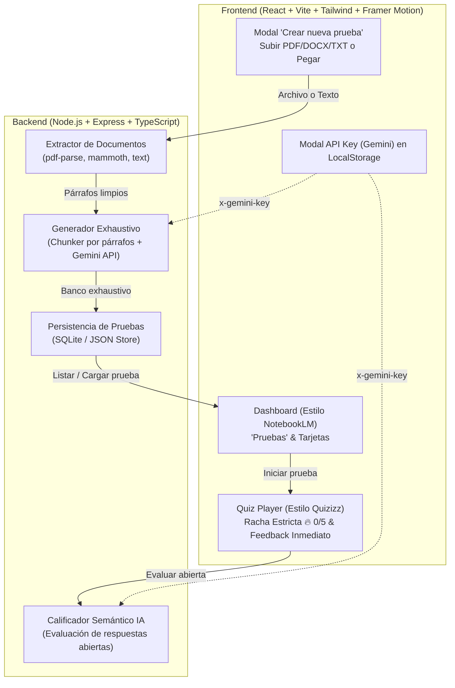

# Especificación de Diseño: MasteryQuiz (InfiQuiz)

> **Fecha:** 2026-10-16  
> **Estado:** Aprobado  
> **Objetivo:** Aplicación web de estudio acelerado por repetición infinita basada en la extracción exhaustiva de preguntas por párrafo de capítulos completos de libros, con interfaz interactiva gamificada estilo Quizizz/Wayground, tablero estilo NotebookLM y evaluador semántico con IA.

---

## 1. Visión del Producto y Reglas de Negocio

### 1.1 Metodología de Estudio
El usuario divide un capítulo en párrafos conceptuales y extrae **la totalidad absoluta de preguntas posibles por cada párrafo** sin dejar ningún detalle, dato o inferencia sin interrogar.

### 1.2 Regla de Maestría Infinita (Racha Estricta 5/5)
- Una vez finalizada la última pregunta del banco del capítulo, el examen **se reinicia inmediatamente y en bucle automático** a la pregunta 1 sin preguntar ni pedir confirmación.
- **Condición de victoria / fin de examen:** El estudiante debe lograr **5 rondas consecutivas completas con 100% de aciertos** (Racha Estricta: si en cualquier ronda se comete 1 solo error, la racha vuelve inmediatamente a 0/5).

### 1.3 Tipologías de Preguntas
1. **Opción Múltiple (`multiple_choice`):** 4 opciones, 1 correcta y 3 distractores basados en el texto.
2. **Verdadero / Falso (`true_false`):** Dos alternativas evaluando matices precisos.
3. **Completar (`fill_blank`):** Término o frase exacta faltante.
4. **Pregunta Abierta / Justificación (`open_ended`):** Respuesta en texto libre evaluada semánticamente con IA.

### 1.4 Dinámica de Feedback Inmediato (Estilo Quizizz)
- **Opciones múltiples / Verdadero o Falso:**
  - Si el usuario acierta: La opción seleccionada se ilumina en **verde vibrante**.
  - Si el usuario falla: La opción seleccionada se ilumina en **rojo vibrante** y **simultáneamente la opción correcta se ilumina en verde**.
- **Preguntas abiertas:**
  - Si acierta: El contenedor se pone verde con mensaje de acierto conceptual.
  - Si falla: El contenedor se pone rojo y la IA despliega una **justificación formativa / pista reflexiva de por qué su respuesta no es correcta** sin regalar de inmediato la solución literal.

---

## 2. Arquitectura del Sistema

---

## 3. Especificación de Endpoints (Backend REST)

1. `POST /api/extract-text`: Acepta `multipart/form-data` con archivo (`.pdf`, `.docx`, `.txt`) o `application/json` con `{ text: string }`. Devuelve `{ paragraphs: string[], totalParagraphs: number }`.
2. `POST /api/generate-questions`: Recibe `{ paragraphs: string[], title: string }` y cabecera `x-gemini-key`. Ejecuta la extracción exhaustiva por párrafos con Gemini 2.5 Flash / 1.5 Flash usando Schema JSON. Devuelve `{ quizId: string, questions: Question[] }`.
3. `POST /api/evaluate-open-answer`: Recibe `{ questionText: string, rubric: string, userAnswer: string }` y cabecera `x-gemini-key`. Devuelve `{ isCorrect: boolean, feedback: string }`.
4. `GET /api/quizzes`: Lista todas las pruebas guardadas.
5. `GET /api/quizzes/:id`: Obtiene una prueba con todo su banco de preguntas.
6. `DELETE /api/quizzes/:id`: Elimina una prueba.
7. `PUT /api/quizzes/:id/stats`: Actualiza estadísticas de maestría y mejor racha.

---

## 4. Diseño de Interfaz de Usuario (UI/UX)

1. **Dashboard NotebookLM:**
   - Barra superior limpia con logo "MasteryQuiz", título "Pruebas" y botón de "Configurar API Key".
   - Botón central heroico: **+ Crear nueva prueba**.
   - Cuadrícula de tarjetas con esquinas redondeadas suaves, fecha, número de preguntas, mejor racha alcanzada y accesos rápidos (Iniciar, Editar, Eliminar).
2. **Modal de Creación:**
   - Pestaña 1: "Subir documento" (área drag-and-drop con soporte PDF, Word y Texto).
   - Pestaña 2: "Pegar texto" (área de texto amplia con contador de caracteres y párrafos detectados).
   - Botón "Generar banco de preguntas" con barra de progreso animada por párrafos.
3. **Reproductor Quizizz:**
   - Banner superior con barra de progreso, indicador de ronda actual y **Contador de Racha Estricta** (`🔥 Racha: 3 / 5 rondas al 100%`).
   - Tarjetas de opción con estética Quizizz (colores vivos: Rojo carmesí, Azul cobalto, Amarillo ámbar, Verde esmeralda).
   - Animaciones con Framer Motion: transiciones instantáneas, sacudida en error, pulso de victoria en acierto.
   - Pantalla de Victoria Suprema cuando se logran las 5 rondas consecutivas al 100%.

---

## 5. Preparación para Render y GitHub
- Monorepo en `mastery-quiz-app/`.
- `package.json` raíz con scripts `npm run build` (compila frontend React y backend TypeScript) y `npm start` (inicia el servidor Express que sirve API y estáticos).
- `render.yaml` declarativo para despliegue automático con un solo clic en Render.
- Repositorio Git vinculado a GitHub bajo `Richicasa`.
